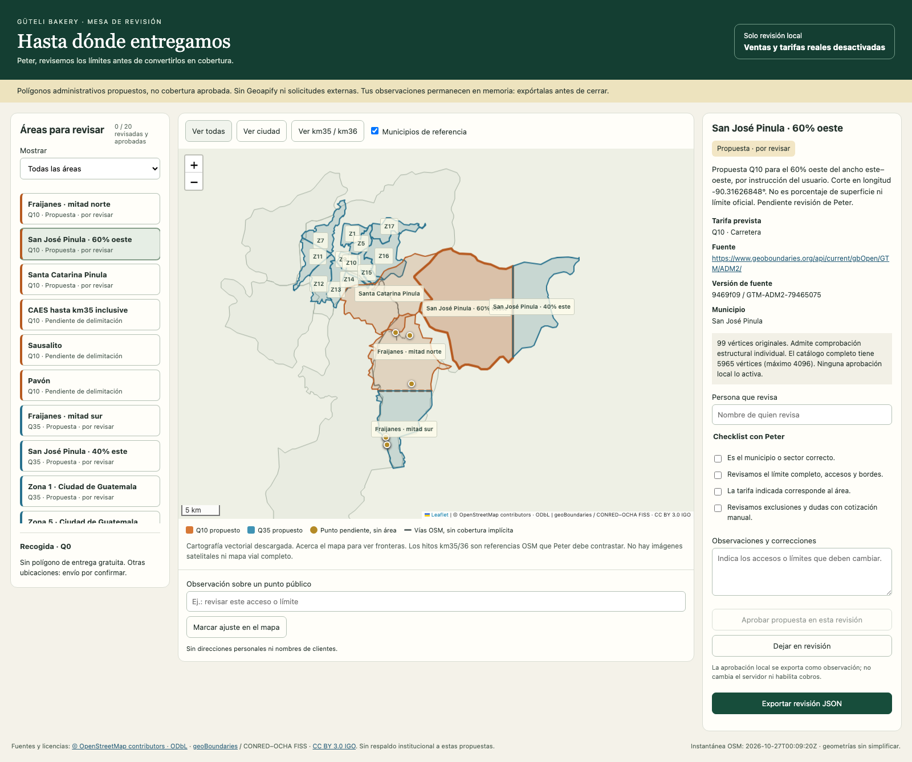

# Mapa acordado — 4 de noviembre de 2026

El usuario expresó conformidad con el mapa local y pidió guardar una captura en
GitHub y una referencia para modificarlo después. Esta evidencia conserva esa
distribución visual. No atribuye una aprobación a Peter ni autoriza activar
tarifas, pedidos, pagos o servicios externos.



## Distribución conservada

| Área                  | Q10 (naranja)       | Q35 (azul)                                        |
| --------------------- | ------------------- | ------------------------------------------------- |
| Fraijanes             | Mitad norte         | Mitad sur                                         |
| San José Pinula       | 60% oeste del ancho | 40% este del ancho                                |
| Santa Catarina Pinula | Municipio completo  | —                                                 |
| Ciudad de Guatemala   | —                   | Zonas 1, 5, 7, 9, 10, 11, 12, 13, 14, 15, 16 y 17 |

Recogida Q0. Otras ubicaciones: envío por confirmar. CAES hasta km35,
Sausalito y Pavón siguen como sectores pendientes de delimitación propia.
Los porcentajes usan rangos de coordenadas, no porcentajes de superficie.

- Fraijanes: corte por latitud media **14.45415725° N**.
- San José Pinula: corte por longitud **-90.31626848259995°**, al 60% del
  rango oeste–este; oeste Q10 y este Q35.
- Versión: `review-2026-10-26-v5`; código y datos base en commit `5673116`.
- [Manifest conservado](manifest.json): versión, fuentes y hashes de las capas.
- [Referencia verificable](reference.json): SHA completo del código base,
  hashes de archivos y PNG, dimensiones y contexto de captura.

La captura proviene de una sesión limpia del visor real, sin notas, nombres de
revisores ni aprobaciones simuladas. Por eso el contador sigue en cero: el
acuerdo de esta conversación se registra aquí, sin completar el checklist en
nombre de otra persona. El catálogo de producción sigue vacío y desactivado.

## Cómo modificarlo en el futuro

1. Abrir el repositorio y ejecutar `npm run delivery:review`; visitar
   `http://127.0.0.1:3140/`. Exportar observaciones antes de recargar o cerrar.
2. Editar [prepare.py](../../../../scripts/delivery-review/prepare.py), que es
   la fuente reproducible de los recortes. Buscar `San José Pinula` y
   `westWidthRatio`: actualmente usa `.60`, porciones `60`/`40` y tarifas
   internas `CAES` (Q10) / `CAPITAL` (Q35). Actualizar conjuntamente cálculo,
   metadatos, nombres y descripción. Para Fraijanes, buscar `original_ring` y
   `cut`: actualmente usa la media de extremos de latitud.
3. Mantener intactas las fuentes en
   [data/delivery-review/sources](../../../../data/delivery-review/sources).
   No editar a mano `areas.geojson` ni `roads.geojson`: se regeneran.
   Incrementar la versión de `manifest.json` en el generador y actualizar
   las expectativas de proporción en las pruebas y la documentación.
4. Regenerar y comprobar desde la raíz:

   ```sh
   python3 scripts/delivery-review/prepare.py
   node --import tsx scripts/delivery-review/validate.ts
   npx vitest run tests/unit/delivery-review.test.ts
   npx playwright test --config playwright.delivery-review.config.ts
   ```

5. Revisar visualmente ambos lados, tarifas y fronteras. Guardar la siguiente
   captura y referencia en una carpeta con fecha nueva; conservar esta evidencia.
   Registrar qué cambió y quién aceptó la nueva distribución antes de publicarla.

El recorte actual admite un anillo y dos cruces por línea. Si otro corte produce
huecos o componentes separados, el generador falla para exigir tratamiento GIS;
no eliminar esa comprobación. El catálogo completo tiene 5965 vértices y todavía
supera los límites del clasificador. Un cambio visual no habilita producción.

Ver [guía del visor y Geoapify](../../delivery-geographic-review.md),
[matriz de comprobaciones](../../delivery-geographic-matrix.md) y
[fuentes/licencias](../../../../data/delivery-review/README.md).

## Comprobación de esta evidencia

El visor cargó sin errores de JavaScript y mostró 20 entradas, con la selección
«San José Pinula · 60% oeste». Se inspeccionó el PNG y se conservaron hashes.
No se cambió código de aplicación ni se repitieron suites para esta captura.
Las pruebas de la versión base están documentadas en su entrega: 7 unitarias
y 2 de navegador aprobadas; son evidencia previa, no una nueva ejecución.
