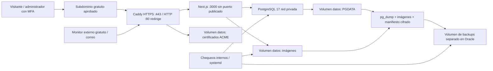

# Arquitectura y límites

Una sola VM implica una sola zona de falla y pausas de mantenimiento. No es alta disponibilidad. Propuesta provisional: Ubuntu 24.04 LTS ARM64, 1 OCPU y 6 GB RAM, boot 50 GB, datos 50 GB y backups 50 GB. Los tres volúmenes consumirían 150 GB; este diseño sólo cabe si la cuenta conserva esa cuota libre. Si el hackathon ya consume recursos, detenerse y revisar capacidad; no reducir ni compartir su servidor automáticamente. El build puede necesitar más memoria que el runtime; se puede construir en otro equipo Linux ARM64 aislado y transferir una imagen verificada, sin aumentar recursos de pago.

App: 2 GiB, PostgreSQL: 1.5 GiB, Caddy: 256 MiB; límites de CPU son topes compartidos, no reservas. Ajustar con mediciones autorizadas. Dependencias reales: Next 16.3.3, React 19.2.7, PostgreSQL 17, Drizzle ORM 0.45.x y sharp 0.35.x. `npm ci` conserva `package-lock.json`; no instala plugins nuevos. El npm local usa Node 23.9.0; la imagen propuesta usa Node 22, así que el build local macOS no certifica Linux/ARM64 ni ese runtime.

## Evidencia de costos consultada el 17/10/2026

| Recurso | Documentación pública | Condición para Güteli |
|---|---|---|
| A1 | 1,500 OCPU-h y 9,000 GB-h/mes; equivalente 2 OCPU/12 GB | Cuota compartida, región principal y capacidad libre; no asumir 4/24. |
| Boot + block | 200 GB combinados y 5 backups de volumen | Restar todos los proyectos y copias existentes. |
| Object Storage | Límites diferentes según estado Free/Trial/Paid | No se usa automáticamente en esta propuesta. |
| Inactividad | Posible recuperación tras 7 días bajo criterios CPU/red/memoria | Aceptar riesgo; nunca generar carga artificial. |

Fuente: [Oracle Always Free](https://docs.oracle.com/en-us/iaas/Content/FreeTier/freetier_topic-Always_Free_Resources.htm). No se consultó ninguna cuenta. La cuota real y elegibilidad de cada selección siguen pendientes.

La [tarifa de red Oracle](https://www.oracle.com/cloud/networking/virtual-cloud-network/pricing/) publica 10 TB mensuales iniciales de salida sin cargo. [IP públicas Oracle](https://docs.oracle.com/en-us/iaas/Content/Network/Tasks/managingpublicIPs.htm) distingue direcciones asignadas a instancias; una IP no es un dominio. No se da por validado aquí el precio de la IP seleccionada: comprobarlo en estimador/Console antes de crearla. No usar balanceadores, NAT Gateway, IPs adicionales, imágenes licenciadas, copias extra, servicios administrados ni volúmenes fuera de cuota/región sin revisar costo y autorización.

**Meta Q0, no garantía de Q0.** Los créditos temporales no prueban gratuidad. Un presupuesto/alerta tampoco impide cobros. No autorizar upgrade de cuenta. Si no cabe una VM independiente: esperar capacidad, revisar otra zona elegible dentro de la región principal, o continuar localmente; no tocar el hackathon. E2 Micro requiere otro dimensionamiento y validación, no es un reemplazo automático apto para este stack.

## DNS, certificados y monitoreo

[DuckDNS](https://www.duckdns.org/about.jsp) ofrece subdominios gratuitos. Es una opción disponible como servicio, **ningún nombre específico fue reservado ni verificado como registrable**. Con autorización, comprobar disponibilidad en su selector; un NXDOMAIN no demuestra que se pueda registrar. No guardar el token en Git ni usar una URL de actualización que aparezca en logs. Un A manual para IP estable evita programar DDNS innecesariamente.

[Caddy HTTPS automático](https://caddyserver.com/docs/automatic-https) obtiene/renueva certificados; esta configuración selecciona Let's Encrypt. Debe existir DNS correcto, puertos accesibles y volumen ACME persistente. Dominio propio es opcional y de pago variable; no se cotiza ni compra.

[UptimeRobot Help](https://help.uptimerobot.com/en/articles/11604710-who-should-use-uptimerobot-s-free-plan) permite uso comercial del plan gratuito: 50 monitores y frecuencia de cinco minutos. Su [guía](https://help.uptimerobot.com/en/articles/11358364-how-to-create-your-first-monitor-on-uptimerobot-quick-setup-guide) contempla notificaciones por correo. La [página de precios](https://uptimerobot.com/pricing/) aún usa una descripción de hobby/nonprofit y coloca SSL/DNS en comparaciones comerciales: reconfirmar en la cuenta las funciones incluidas, sin habilitar trials. No se promete alerta anticipada de vencimiento TLS gratuita; una conexión HTTPS inválida debe provocar fallo del monitor. Correo y contactos reales requieren autorización.

## Controles y límites

- Sólo Caddy publica 80/443. `database` usa red interna; app no tiene puertos host. El proxy sobrescribe X-Forwarded-For/Host/Proto y elimina Forwarded/X-Real-IP. Un solo salto confiable. No añadir CDN sin revisar toda la cadena.
- [Docker advierte](https://docs.docker.com/engine/install/ubuntu/) que puertos publicados pueden eludir UFW; OCI NSG y revisión de `DOCKER-USER`/backend de firewall son necesarios. No afirmar aislamiento basándose sólo en UFW.
- Bind mounts largos con `create_host_path: false`; preflight exige UUID y mountpoint exactos. Guardas de contenedor comprueban mountinfo, marcador y PG_VERSION. No hay inicialización implícita de base vacía en arranque normal.
- Usuario no root en los tres servicios; sin capacidades, no-new-privileges, filesystem de imagen de sólo lectura, tmpfs limitado y rotación de logs. Docker/root del host sigue siendo un privilegio amplio.
- MFA, Origin, cookies seguras y protección del último OWNER se preservan. `.env`/copias/logs nunca se sirven. No hay access logs de Caddy; PostgreSQL no registra statements de error. El runtime de autenticación conserva riesgos residuales: no exportar logs crudos, probar canarios y revisar adaptadores antes de abrir acceso real.
- Noindex en metadatos y cabeceras protege contra indexación cooperativa, **no proporciona privacidad**. El catálogo público sólo puede contener material aprobado.
- `restart: unless-stopped` recupera salidas de proceso según Docker; un contenedor `unhealthy` no se reinicia por ese motivo. Ver [políticas de reinicio](https://docs.docker.com/engine/containers/start-containers-automatically/) y [orden de Compose](https://docs.docker.com/compose/how-tos/startup-order/). No hay watchdog que reinicie PostgreSQL indiscriminadamente.
